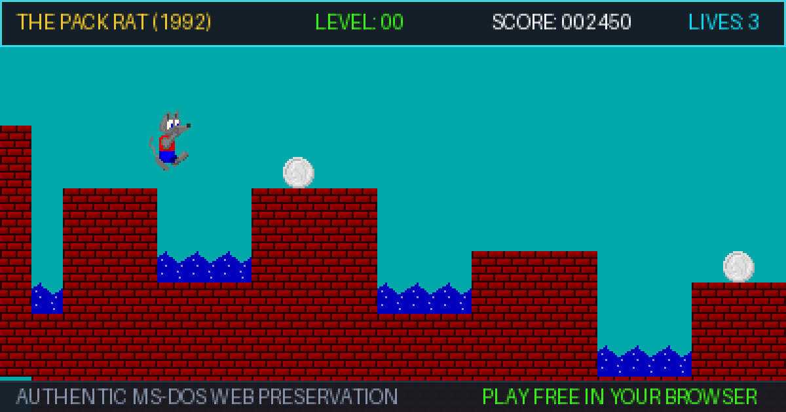

# The Pack Rat (1992) — Authentic Web Edition

[](LICENSE)
[](https://github.com/CambrianMinds/the-pack-rat/actions/workflows/test.yml)
[](#-features--preservation-highlights)
[-informational.svg)](#-quick-start)
[](#-historical-context--preservation)

> **A pixel-perfect, reverse-engineered web preservation of Steve Blanding's classic 1992 MS-DOS platformer.**  
> Reverse-engineered from original 16-bit real-mode binaries (`PACKRAT.EXE` & `PACKRAT.001`) into modern HTML5 Canvas, Web Audio, and Vanilla JavaScript. Runs instantly in any desktop or mobile browser with zero build steps or runtime dependencies.

<p align="center">
  
</p>

---

## 📑 Table of Contents

- [🕹️ Quick Start](#️-quick-start)
- [✨ Features & Preservation Highlights](#-features--preservation-highlights)
- [🎮 Controls](#-controls)
- [💎 Scoring & Collectibles](#-scoring--collectibles)
- [🧱 Gameplay Mechanics & Hazards](#-gameplay-mechanics--hazards)
- [🛠️ Built-in Level Editor](#️-built-in-level-editor)
- [🔬 Reverse Engineering & Architecture](#-reverse-engineering--architecture)
- [🧪 Automated Test Suite](#-automated-test-suite)
- [🚀 GitHub Pages Deployment](#-github-pages-deployment)
- [📜 Historical Context & Preservation](#-historical-context--preservation)
- [📄 License & Credits](#-license--credits)

---

## 🕹️ Quick Start

This project has **zero external runtime dependencies** and requires **no build step**.

### Option A: Play Locally
1. Clone or download this repository:
   ```bash
   git clone https://github.com/<your-username>/the-pack-rat.git
   cd the-pack-rat
   ```
2. Open `index.html` directly in any web browser, or launch a local server:
   ```bash
   # Using npm
   npm start

   # Or using Python 3
   python -m http.server 8000
   ```
3. Navigate to `http://localhost:8000` (or the port displayed).

### Option B: Play Online
Deploy directly to **GitHub Pages** (see [GitHub Pages Deployment](#-github-pages-deployment)) to play instantly on desktop, tablet, or phone.

---

## ✨ Features & Preservation Highlights

- 🐭 **1:1 MS-DOS Physics Recreation:** Rebuilt using formulas extracted from the original x86 disassembly—including authentic jump arcs, variable jump impulse, ground friction, ice inertia, push thresholds, and real-mode collision boundaries.
- 🗺️ **All 16 Original Compressed Levels:** Decompressed directly from `PACKRAT.001` using an adaptive binary arithmetic decoder reverse-engineered from the original MS-DOS decompression routine.
- 🎨 **Authentic 256-Color VGA Visuals:** 52 original terrain tiles, 17 Pack Rat animation frames, enemy rat sprites, and the authentic 256-color VGA DAC palette extracted directly from `PACKRAT.EXE`.
- 🌊 **Dynamic Visual Cycles:** Authentic 32-step water ripple cycle animation and live electric current waypoints running on real-time lookup tables.
- 🔊 **Web Audio PC Speaker Synthesizer:** Real-time square-wave synthesis driven by the original frequency and timer tick duration tables extracted from the executable.
- 📱 **Mobile & Gamepad Ready:** Fully responsive with on-screen virtual touch D-pad and buttons for mobile devices, plus native plug-and-play Gamepad API support (Xbox, PlayStation, standard HID controllers).
- ⌨️ **Customizable Keybindings:** Remap any control at runtime with settings automatically saved to `localStorage`.
- 📺 **Arcade CRT Shader:** Optional authentic scanline, shadow mask, and phosphor glow filter.
- 🏆 **Persistent Hall of Fame:** Local high-score tracking pre-populated with Steve Blanding's original 1992 leaderboard.
- 🛠️ **Built-in 64×64 Level Editor:** Create, test-play, export, and import custom levels with mouse hole warp destinations and custom palettes.
- 🧪 **49-Test E2E Verification Suite:** Automated headless and in-browser testing validating every collision, physics interaction, and mechanic against DOS ground truth.

---

## 🎮 Controls

All keyboard controls can be customized at any time by opening the **🎮 CONTROLS** modal from the toolbar.

| Action | Default Keyboard | Mobile Touchscreen | Gamepad (Standard) |
| :--- | :--- | :--- | :--- |
| **Move Left** | `←` or `A` | Virtual D-Pad Left | D-Pad Left / Left Analog Stick |
| **Move Right** | `→` or `D` | Virtual D-Pad Right | D-Pad Right / Left Analog Stick |
| **Look Up / Climb Spools** | `↑` or `W` | Virtual D-Pad Up | D-Pad Up / Left Analog Stick |
| **Look Down / Dislodge** | `↓` or `S` | Virtual D-Pad Down | D-Pad Down / Left Analog Stick |
| **Jump** | `Space`, `Ctrl`, or `Z` | **JUMP** Button | **A** / Cross Button |
| **Push Block** | `Alt`, `Shift`, or `X` | **PUSH** Button | **X** / Square Button |
| **Minimap / Zoom View** | `M` | **ZOOM** Button | Right Bumper |
| **Suicide (if trapped)** | `K` | — | Back / Select |
| **Pause / Resume** | `Esc` or `F3` | Toolbar Pause | Start / Menu Button |
| **Toggle Sound** | `F2` | Toolbar Sound | Left Bumper |
| **Toggle CRT Shader** | `C` | Toolbar CRT | — |
| **Toggle HUD** | `F10` | — | — |
| **Help Manual** | `F1` | **HOW TO PLAY** | — |

---

## 💎 Scoring & Collectibles

As The Pack Rat, your objective is to gather shiny baubles and locate mouse holes leading to subsequent stages:

| Item | Sprite | Points | Behavior |
| :--- | :---: | :---: | :--- |
| **Button** | 🔘 | **10** | Standard collectible scattered throughout levels |
| **Silver Coin** | 🥈 | **25** | Valuable shiny treasure |
| **Gold Coin** | 🥇 | **50** | High-value currency |
| **Cookie** | 🍪 | **100** | Sweet snack hidden in trickier spots |
| **Cheese** | 🧀 | **250** | Prize delicacy, often tucked in secret areas |
| **Level Clear** | 🕳️ | **500** | Awarded each time you exit through a Mouse Hole |
| **Extra Life** | 🐭 | **+1 Life** | Awarded for every **10,000 points** accumulated |

---

## 🧱 Gameplay Mechanics & Hazards

### Physics & Block Mechanics
- **Thread Spools:** Solid platforms that roll horizontally when pushed with `Push + Direction` (1 hit required). Pack Rat can climb vertically up stacked spool shafts by holding `Up`, or descend by pressing `Down`.
- **Ice Blocks:** Slippery blocks that require 3 sustained pushes to break static friction and slide. Crouching and pressing `Down` 3 times dislodges them downward.
- **Dislodgeable Bricks:** Weakened bricks will crumble and fall when jumped on repeatedly or dislodged from above (5 hits required).
- **Rubber Bands:** Act as springboards. Landing on a rubber band bounces The Pack Rat upward; holding `Jump` at the moment of impact unleashes a **super trampoline bounce**. Pack Rat can also walk through rubber bands without unwanted bouncing.
- **Illusionary Tiles:** Certain bricks and water surfaces are illusions concealing hidden corridors, shortcut tunnels, and secret stashes. You can walk straight through illusionary walls and across illusionary water without harm.
- **Pipe Networks:** Stepping into a pneumatic pipe transport automatically propels The Pack Rat through connecting tubing to remote areas of the level.

### Hazards
- **Pits / Void:** Falling off the bottom boundary of the level immediately costs one life.
- **Mousetraps:** Snaps shut instantly upon contact.
- **Water Pools:** Non-illusionary water drowns the Pack Rat.
- **Electric Wires & Live Currents:** Touching active wires or moving electric spark pulses causes instant electrocution.
- **Enemy Rats:** Patrol territory along floors; collision is fatal.

---

## 🛠️ Built-in Level Editor

The web edition includes a full-featured in-browser level editor:

1. Click the **🛠️ EDITOR** button on the top toolbar to switch into editor mode.
2. **Features:**
   - **64×64 Tile Canvas:** Click or drag to paint any of the 52 extracted terrain, hazard, and item tiles.
   - **Warp Destinations:** Configure target level destinations for each mouse hole.
   - **Background Palette Selection:** Toggle background sky and chamber colors.
   - **Instant Test Play:** Click **TEST PLAY** to immediately playtest your custom level at full physics fidelity.
   - **Import & Export:** Export your creations as formatted JSON or load community-created level packages.

---

## 🔬 Reverse Engineering & Architecture

This preservation was achieved by disassembling and decompressing the original 1992 MS-DOS shareware release:

### 1. `PACKRAT.001` Level Decompression
The original level data is stored in `PACKRAT.001` using a custom 10th-order adaptive binary arithmetic compression algorithm. The decompression engine:
- Maintains a 1,024-entry probability context model.
- Decodes bit-by-bit via 16-bit range renormalization (`range` and `code` registers).
- Successfully reconstructed all 16 levels into their authentic 64×64 tile matrices, complete with mouse hole destination lookup tables and color palettes.
- See [`extract.py`](extract.py) for the standalone Python reference decompressor.

### 2. `PACKRAT.EXE` Asset Extraction
- **VGA Palette:** Extracted from data segment offset `DS:0x0042` (768 bytes, 6-bit DAC values scaled to 8-bit sRGB).
- **Sprite & Tile Sheets:** Decoded from 4-bit and 8-bit planar VGA memory layouts into raw RGBA ImageData bitmaps, packaged in [`assets.js`](assets.js).
- **Sound Tables:** PC Speaker frequency divisor values and duration counts extracted from executable lookup tables and converted into Web Audio API oscillators in [`audio.js`](audio.js).

### 3. Repository Architecture
```text
the-pack-rat/
├── index.html         # Main web game entry point & arcade interface
├── game.js            # Core engine: DOS physics, collision loop, state machine, level editor
├── assets.js          # Extracted levels (0-15), 61 tile graphics, sprite frames, and palette
├── audio.js           # Authentic Web Audio API PC speaker frequency synthesizer
├── style.css          # CRT styling, arcade marquee, responsive mobile controls & layout
├── package.json       # Project metadata and test scripts
├── README.md          # Comprehensive project documentation
├── LICENSE            # MIT License
├── docs/              # Guides, walkthroughs, and documentation
│   ├── walkthrough.html   # Interactive visual walkthrough & secret guide
│   ├── cheat_guide.pdf    # Printable 5-page PDF cheat guide & stage directory
│   ├── cheat_guide.tex    # LaTeX master source with side-by-side secret cards
│   └── *.png              # Progression maps and annotated level secret cards
├── tests/             # Automated test suite (51 E2E tests)
│   ├── test-e2e.js        # Automated Node.js CLI test runner
│   ├── tests-core.js      # Core test specifications (physics, collisions, hazards)
│   └── test.html          # In-browser diagnostic test runner
├── images/            # Background art and social preview cards
├── scripts/           # Python extraction, disassembly, and map rendering tools
├── original-source/   # Original 1992 MS-DOS binaries (PACKRAT.EXE, PACKRAT.DAT)
└── tiles/             # Dumped raw 16x16 and 32x32 tiles & sprite frames
```

---

## 🧪 Automated Test Suite

A comprehensive test suite of **51 end-to-end tests** validates the game engine against DOS behavior:

- **Collision & Map Bounds:** Floor detection, pit death boundaries, void falloff, horizontal borders.
- **DOS Physics:** Jump velocity, gravity acceleration, variable height impulse, ceiling collision, ice friction.
- **Complex Interactions:** Rubber band bounce formulas, spool push hits, spool climbing/descending, ice block dislodging, brick crumbling.
- **Hazards & Scoring:** Mousetraps, water drowning, electric current patrols, enemy rat collision, suicide hotkey (`K`), collectible point values, extra life triggers.
- **Audio Integrity:** Silent sound verification ensuring tests execute cleanly in CI/headless environments without unprompted audio context warnings.

### Running CLI Tests
```bash
npm test
# or
node tests/test-e2e.js
```

### Running Browser Tests
Simply open [`tests/test.html`](tests/test.html) in any modern browser to view the interactive test suite with detailed assertion reports.

---

## 🚀 GitHub Pages Deployment

The game is pre-configured for one-click hosting via GitHub Pages:

1. Push your repository to GitHub.
2. Go to **Settings** → **Pages** in your repository.
3. Under **Build and deployment** > **Source**, choose **Deploy from a branch**.
4. Set the branch to `main` (or `master`) and directory to `/ (root)`.
5. Click **Save**.
6. Your game will be live at `https://<your-username>.github.io/the-pack-rat/` within minutes!

---

## 📜 Historical Context & Preservation

*The Pack Rat* was created by **Steve Blanding** in Redmond, Washington, and released in **1992** as shareware for IBM PC-compatibles running MS-DOS. 

The original release notes required:
> *"At least a 386 micro-processor with a VGA compatible graphics card. The game plays best on at least a 25MHz 386."*

Included in this repository are the original historical documents:
- [`PACKRAT.TXT`](PACKRAT.TXT) — The original 1992 user documentation and system requirements.
- [`REGISTER.FRM`](REGISTER.FRM) — The original $15 mail-in shareware registration form.

---

## 📄 License & Credits

- **Original MS-DOS Game (1992):** © Steve Blanding, Redmond, WA.
- **Web Preservation & Reverse Engineering (2026):** Justin Bogner.
- **Code License:** The web recreation source code, extraction tooling, and test suite are licensed under the [MIT License](LICENSE).

